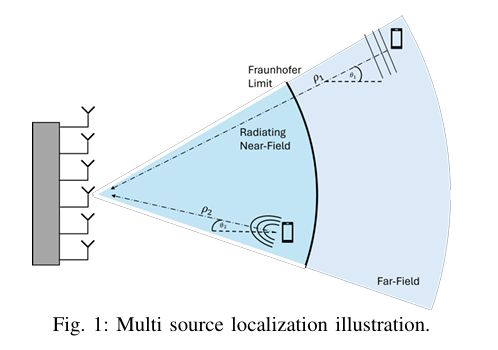
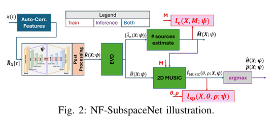
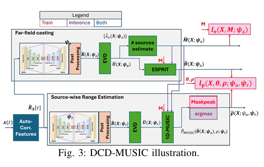
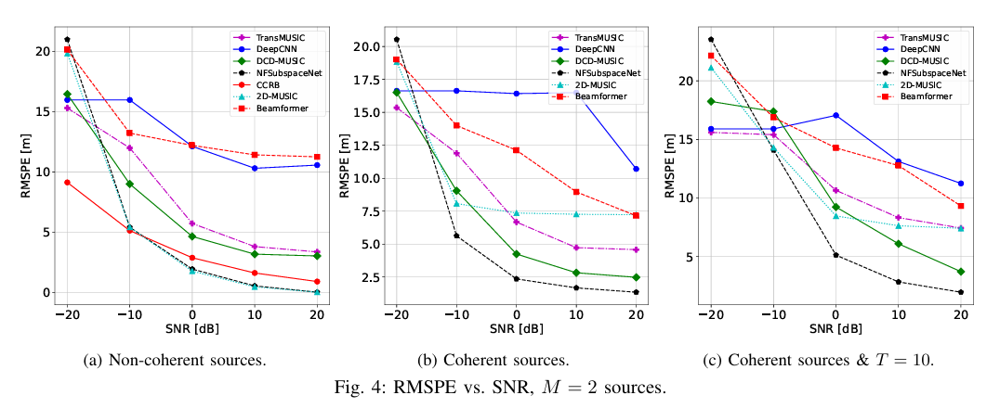
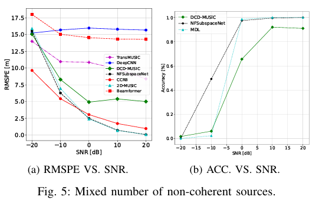
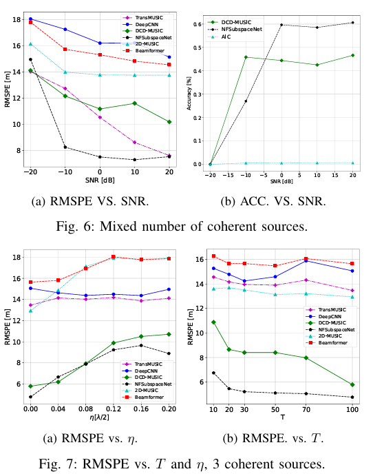
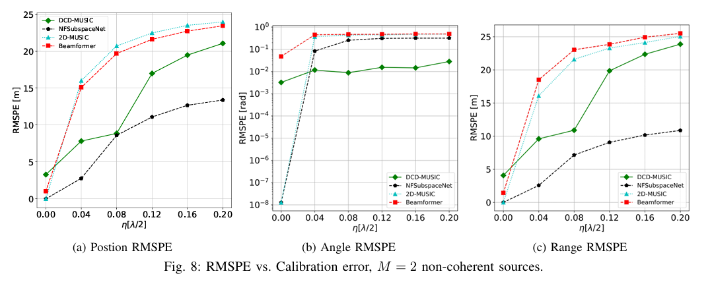
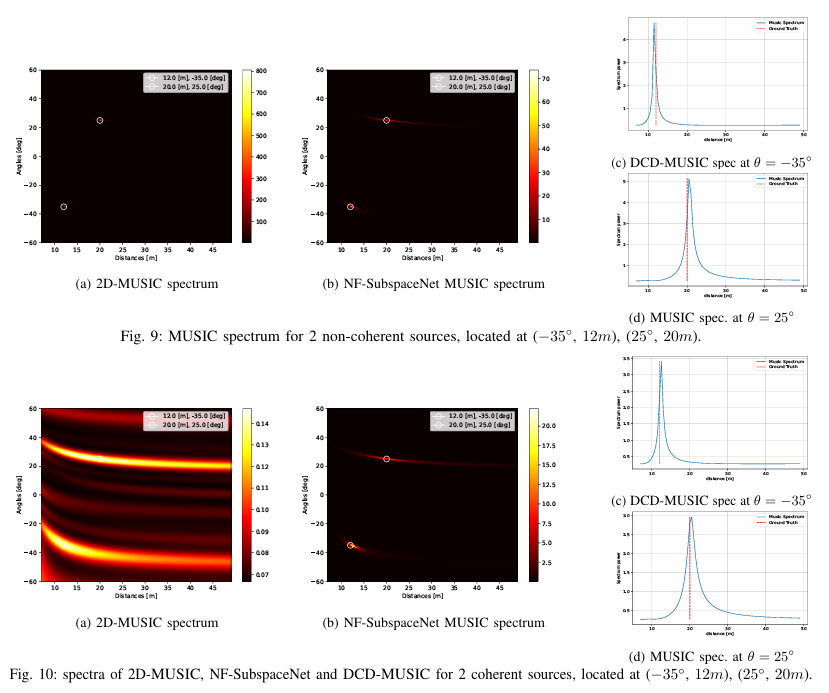
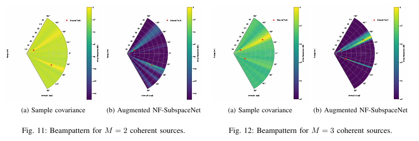

# DOA Estimation: Near-Field Positioning Based on Artificial Intelligence-Assisted Subspace Methods [with Python Code]

Abstract: The increasing demand for high throughput and high energy efficiency wireless communication has driven the development of technologies using ultra-large scale antennas in high frequency bands. In these scenarios, multiple users will be located near the radiation field, making precise positioning crucial. Unlike traditional far-field systems that rely solely on direction of arrival (DoA) estimation, near-field positioning leverages spherical wave propagation characteristics to simultaneously recover both DoA and distance information. Although subspace methods based on MUSIC algorithm and its extensions have high resolution and interpretability in near-field positioning, their performance is limited by modeling assumptions such as non-coherent sources, well-calibrated arrays, and sufficient number of snapshots. To address these limitations, this paper proposes an AI-assisted subspace method for near-field positioning, enhancing robustness against real complex scenarios. Specifically, we introduce NF-SubspaceNet—a deep learning-enhanced 2D MUSIC algorithm that improves positioning performance under complex conditions by learning an alternative covariance matrix; and DCD-MUSIC—a cascading AI-assisted method that reduces computational complexity by decoupling angle and distance estimation. We also develop a novel training method for model order sensitivity, combining AI-modeled near-field subspace methods with the accuracy of source number estimation. Extensive simulations show that the proposed methods outperform traditional and existing deep learning positioning techniques, achieving robust near-field positioning even in scenarios with coherent sources, array mismatch, and few snapshots.
The combination of ultra-large surface antennas and high-frequency signals poses two key considerations: First, the precise positioning of mobile devices is crucial as it forms the basis for generating focused beams by base stations, which are particularly important in the high-frequency band [8]. Second, Fraunhofer's capabilities extend up to several meters [9], meaning some users may be within the near-field (hereafter referred to as near-field) radiation zone [10,11].
The presence of near-field users introduces capabilities that traditional far-field systems lack. Far-field narrowband sources can only locate through the direction of arrival (DoA), whereas near-field spherical wavefronts can simultaneously recover both the DoA and distance [12]. Algorithms used for multi-near-field source localization include beamforming [13], maximum likelihood computation [14], compression-sensing techniques [15,16], cumulative-based schemes [17,18], zero-space projection [19], and subspace methods based on covariance [20-26]. The latter includes the near-field extension of MUSIC algorithms such as 2D MUSIC [20,21], multi-level MUSIC [22-25], and iterative 1D MUSIC-like methods [26]. Subspace methods have advantages such as unrestricted resolution by array geometry, natural support for multi-source localization, interpretability (providing meaningful spectral representations), and simplicity of implementation. However, they rely on non-coherent sources, assume good array calibration, and require sufficient number of fast shots. Once these assumptions are violated, performance significantly drops.
Another method for positioning that does not rely on model assumptions is to learn the pattern of positioning from data, which relies on the latest advancements in artificial intelligence (especially deep learning [28]). Various deep neural networks are used for this task, including multilayer perceptrons [29,30], convolutional neural networks [31-38], and attention models [39,40]. Although black-box architectures rely on high-parameterized and unexplainable models trained with large amounts of data, deep neural networks can be combined with classical positioning algorithms through model-based deep learning [41]. In far-field DoA recovery, various subspace methods have been proposed for integration with deep neural networks [42-49], including training deep neural networks to generate MUSIC spectra [42,43] and computing covariance matrices (approximating true covariance or as an alternative covariance for downstream DoA recovery [44-46] or [47-49]). The latter overcomes limitations such as coherent sources, but existing methods are only applicable to far-field and depend on differentiable DoA estimation, which cannot be extended to near-field.
This paper proposes an AI-assisted subspace method for near-field positioning, aiming to preserve the interpretability of the subspace near-field positioning estimator (especially by effectively identifying the number and location of sources through effective feature spectra and MUSIC spectra), while addressing challenges such as coherent sources, array mismatch, and few shots.
Conclusion: This paper presents two AI-assisted subspace algorithms for near-field positioning: NF-SubspaceNet derived from near-field MUSIC, and DCD-MUSIC, an enhanced version of ESPRIT-MUSIC method. A dedicated training scheme was designed to jointly evaluate the effectiveness of MUSIC spectra, source number recovery accuracy, and positioning performance. Experimental evaluations show that the proposed AI-assisted methods achieve precise positioning in complex scenarios, outperforming traditional model methods and data-driven benchmark algorithms.
Future research can be expanded in multiple directions: extending the method to 3D near-field positioning with planar arrays [67], or to sparse arrays [68] to address the challenge of virtual element calibration using data; modeling near-field positioning as a machine learning model, achieving joint learning with downstream tasks such as tracking [69], for example, learning the most useful features for tracking, utilizing tracking confidence for online adaptiveness, and even joint learning of positioning and tracking [70]. These extensions are pending future research.

## Images

<!-- PAYMENT_BLOCK -->

## Get this dataset

- Payment link (Stripe): [Buy now](https://buy.stripe.com/3cs8yP7sY87d0vu9AB)
- Payment QR code: 

<!-- /PAYMENT_BLOCK -->
